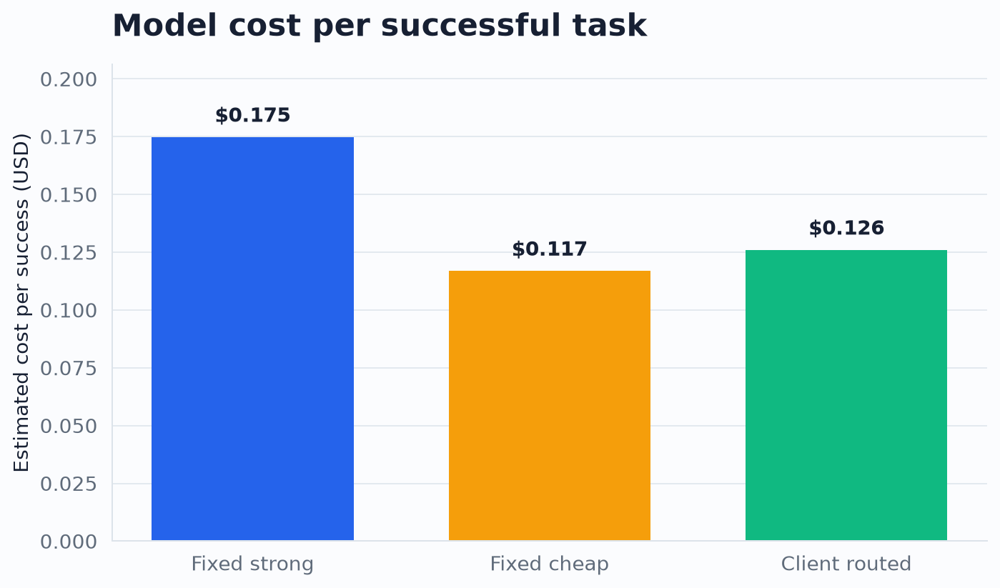
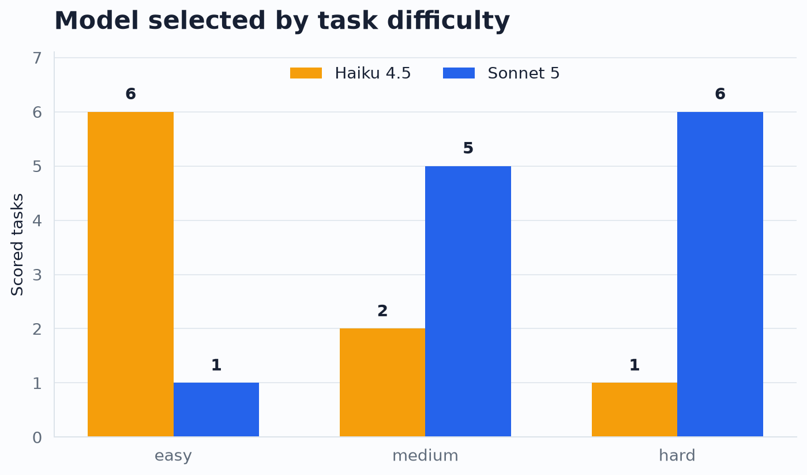

# A 72-run test of prompt-based model routing for coding agents on Databricks

One small router matched the stronger model's task success rate while reducing
estimated model inference cost by 27.9%.

That result comes from 72 attempted coding-agent runs through Databricks Unity
AI Gateway: 24 tasks with Claude Sonnet 5 pinned, the same 24 with Claude Haiku
4.5 pinned, and the same 24 through a transparent client-side router. The corpus
audit found defects in three tasks. I excluded each task from all arms, leaving
21 scored tasks per strategy.

The client-routed arm passed 21 of 21 scored tasks. Fixed Sonnet also passed
21 of 21. Fixed Haiku passed 20 of 21 and had the lowest absolute cost.

## Result in one table

| Strategy | Scored success | Estimated model cost | Cost per success | Median task time | Gateway tokens |
| --- | ---: | ---: | ---: | ---: | ---: |
| Fixed Sonnet 5 | 21/21 | $3.670 | $0.175 | 55.9 s | 7.23M |
| Fixed Haiku 4.5 | 20/21 | $2.337 | $0.117 | 76.8 s | 10.66M |
| Client routed | 21/21 | $2.645 | $0.126 | 65.0 s | 6.88M |

The routed strategy cost 27.9% less than fixed Sonnet at the same observed
success rate. It cost 13.2% more in total than fixed Haiku, or 7.8% more per
successful task, while recovering Haiku's one failure. Its median completion
time landed between the two fixed arms.

Treat 27.9% as the result of this small engineering benchmark. One run per task
cannot establish statistical equivalence. The recorded mechanism and failure
modes give another team enough information to reproduce the comparison.

## Router policy

The router used Haiku 4.5 as a selector. It received the task title and request,
then returned `cheap` or `strong` plus one short reason. The selector had no
access to the difficulty label, verifier, expected output, or another arm's
result.
The runner then launched Claude Code through [`ucode`](https://github.com/databricks/ucode)
with Haiku 4.5 or Sonnet 5 pinned.

The frozen policy favored Haiku for localized, explicit, low-risk changes. It
favored Sonnet for ambiguous debugging, concurrency, state transitions, SQL,
security-sensitive behavior, and work spanning several components. The
benchmark records the policy text and SHA-256 hash.

Across the 21 scored tasks, the router selected Haiku 9 times and Sonnet 12
times:

| Corpus label | Haiku | Sonnet |
| --- | ---: | ---: |
| Easy | 6 | 1 |
| Medium | 2 | 5 |
| Hard | 1 | 6 |

The selector could not see those labels. Its choices tracked the corpus without
sending each "hard" task to the stronger model by default.
For example, it sent a localized string-building optimization labeled hard to
Haiku, and that run passed.

The most useful individual result was `medium-002`, an async cancellation bug.
Fixed Haiku failed it. Fixed Sonnet passed. The router described cancellation
semantics and state management as the risk, chose Sonnet, and passed. One task
cannot validate the policy. It does demonstrate the behavior routing is meant
to provide.

## Why the cheap model used more tokens

Fixed Haiku made 394 gateway invocations across the scored tasks, compared with
235 for fixed Sonnet and 285 for the routed strategy. Its 10.66 million gateway
tokens were also 47% above fixed Sonnet's total.

Lower token price did not make the cheap model more efficient at completing the
work. It often needed more turns and more accumulated context. Haiku still had
the lowest estimated cost because the captured rates were half of Sonnet's for
each input, output, cache-read, and cache-write category.

Request price alone says little about coding-agent efficiency. Cost per
successful task accounts for retries, long tool loops, and failed outcomes.

## What Databricks provided

Every selector and worker request ran through Unity AI Gateway. The run used
`system.ai.claude-haiku-4-5` and `system.ai.claude-sonnet-5`, both backed by
current models listed in the [Databricks supported-model documentation](https://docs.databricks.com/aws/en/machine-learning/foundation-model-apis/supported-models).
Claude Code and the task verifier remained constant across arms.

`system.ai_gateway.usage` supplied the destination model, token counts, cache
activity, latency, status code, and invocation identity for attribution.
Databricks documents that table as the usage source for model services and also
states that usage tracking carries a separate charge. [Track model usage](https://docs.databricks.com/aws/en/ai-gateway/usage-tracking)
describes the schema and access requirements.

The analysis matched requests to exact, non-overlapping run windows after
filtering the source query to the benchmark requester. The final attribution
contained 1,105 unique invocation IDs and no duplicate assignment between
runs. The public evidence removes requester, request, invocation, endpoint,
account, and workspace identifiers.

## Cost means estimated model inference cost

The estimate uses token records from the gateway and a price snapshot captured
from the live model catalog on 2026-09-03. It applies distinct rates to uncached
input, cache reads, cache writes, and output.

The estimate does not include SQL warehouse use, the separate charge for AI
Gateway usage tracking, discounts, promotional credits, taxes, or human time.

An immediate query of `system.billing.usage` returned no rows for the benchmark
window. Databricks says most workspaces receive billing records within 12 hours,
while new workspaces can take longer. [Billable usage system table](https://docs.databricks.com/aws/en/admin/system-tables/billing)
documents that delay. The article therefore reports a reproducible model-price
estimate, not an invoice amount.

## What this benchmark measures

This experiment tests a transparent client-side policy, identified throughout
as `CLIENT_ROUTING`. It records every model decision and measures the
strong-versus-cheap routing pattern on Databricks infrastructure. It does not
measure or make claims about Databricks' proprietary Smart Routing algorithm.

This distinction matters because published routing work often frames the
problem as choosing between stronger and weaker models to balance
quality and cost. [RouteLLM](https://arxiv.org/abs/2406.18665) is one primary
example. You can study the architecture without relying on a particular
vendor's policy. Databricks documents its separate managed implementation in
[Smart Routing for coding agents](https://docs.databricks.com/aws/en/ai-gateway/smart-routing).

## The corpus audit changed the denominator

All 72 arm-task combinations ran. Three task fixtures were invalid at the base
commit:

- `easy-004` compared SQLite tuple rows with unnormalized CSV list rows, making
  the verifier reject a correct result.
- `medium-007` had seed data that disagreed with its expected CSV, and its
  starting query did not create the fanout described by the task.
- `hard-005` already forwarded the asserted timeout. Synchronous server
  teardown created the apparent hang, so the starting implementation satisfied
  the actual assertion.

I excluded each task from all three arms before computing headline metrics and
kept the raw attempts. The exclusion file names the exact benchmark base commit;
the repository contains corrected fixtures for future reruns.

This audit also found a harness bug: the forbidden-file checker evaluated paths
from the wrong Git root. One Haiku run had modified a forbidden seed file, but
the original checker missed it. The repaired checker uses paths relative to the
nested task repository and has a real Git regression test.

## What the result supports

The client router found a useful middle point in this run. It matched fixed
Sonnet's observed quality, approached fixed Haiku's cost, and finished faster
than fixed Haiku at the median. It also made a defensible choice on the sole
scored task where the fixed models disagreed.

The evidence does not establish a universal routing policy. The sample has 21
valid tasks, one observation per arm and task, and no randomized arm schedule.
The arms ran one after another, so service conditions can confound timing. Model behavior
is nondeterministic, the selector is itself a model, and the task set reflects
one small coding corpus. Candidate availability and prices will change.

A stronger follow-up would repeat each task several times and interleave arms.
The practical finding remains narrow: a disclosed, prompt-only router preserved
task success while cutting strong-model spend in this corpus, measured against
completed work and audited fixtures.
